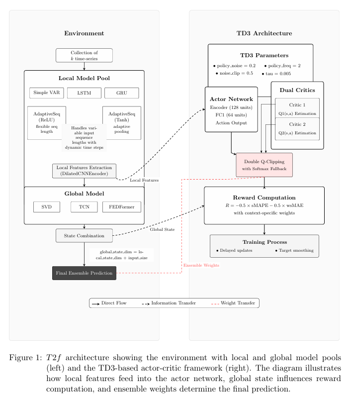

## T2f: Transformer-based Twin Delayed Deep Deterministic policy gradient for forecasting

Integrating Actor-Critic Reinforcement Learning with Temporal Attention for Local-Global time-series Forecasting



### Main repository components

 * [t2f](./t2f)
   * [local_model_pool.py](./t2f/local_model_pool.py): diverse model pool focusing on individual series characteristics 
   * [t2f_base.py](./t2f/t2f_base.py): full dual-stage implementation of the T2f algorithm, including dilated encoding method and global prediction transformer
   * [helpers.py](./t2f/helpers.py): key preprocessing and evaluation methods
 * [benchmarks](./benchmarks)
   * [bench_base.py](./benchmarks/bench_base.py): combined benchmarking script enabling 1-click error based performance comparison of selected model pool vs. T2f
   * [model_classes.py](./benchmarks/model_classes.py): implementation of diverse competing models for benchmarking vs. T2f

### Recommended environment

This repository is designed to run reliably on Python 3.11.x.

- Recommended interpreter: Python 3.11
- Avoid Python 3.14 for the full project run because package compatibility and pip behavior were inconsistent in the current environment.
- Create a virtual environment and install the pinned dependencies from [requirements.txt](requirements.txt) or [pyproject.toml](pyproject.toml).

### Quick start

1. Open a terminal at the repository root.
2. Create a virtual environment:
   ```powershell
   py -3.11 -m venv .venv
   .\.venv\Scripts\Activate.ps1
   python -m pip install --upgrade pip
   python -m pip install -r requirements.txt
   ```
3. If the ELD dataset has not been generated yet, run the dataset prep step or extract the archive in [datasets/eld](datasets/eld):
   ```powershell
   python -c "import py7zr, pathlib, shutil; from pathlib import Path; base = Path('datasets/eld'); z = py7zr.SevenZipFile(base / 'eld.7z', 'r'); z.extractall(base); p = next(base.glob('*.parquet')); if not (base / 'diff_eld.parquet').exists(): shutil.copy2(p, base / 'diff_eld.parquet'); print('dataset ready')"
   ```
4. Open [run.ipynb](run.ipynb) and select the .venv kernel.

### Usage

The notebook [run](run.ipynb) demonstrates simple usage of T2f for generating forecasts, together with a complete benchmarking run assuming the models classed in the classes [module](benchmarks/model_classes.py). Both final error metric results and comparative plots are written to the [benchmarks](benchmarks) directory.

Configuration fields in [run.ipynb]:

```
ep = 2
dataset='eld'
input_data_path='./datasets/eld/diff_eld.parquet'

series_id_col='id'                      ## column keeping the local series index
timestamp_col='timestamp'               ## column with relevant timestamp
timestamp_format='%Y-%m-%d %H:%M:%S'    ## string format for timestamp_col
covariate_cols=['tmax', 'tmin', 'tmed'] ## covariates to consider

weight_col='cost_kwh'                   ## objective weight variable (can be part of the prediction covariates)
target_col='load'                       ## prediction variable

local_length=2                          ## Controls the output sequence length from local stage
global_length=3                         ## Controls the output sequence length from global stage

test_size=0.2
batch_size=16

## models to be included for testing
models = ['AUTOARIMA', 
          'GARCH', 
          'N-BEATS', 
          'Prophet', 
          'GRU', 
          'TCN', 
          'DeepAR local', 
          'DeepAR global'
         ]
```

#### Note: The script in [combine_benchmarks](combine_benchmarks.py) facilitates the aggregation of results produced accross multiple dataset & epoch pairs in one single json dict.
